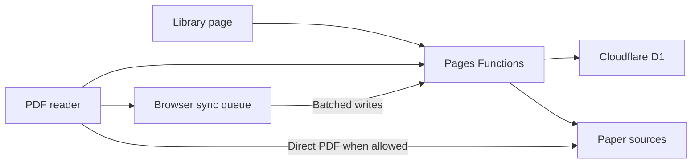

# Paper Reader architecture

Paper Reader runs on Cloudflare Pages. Vite builds the library and PDF reader as separate entry points. The browser fetches library records through same-origin Pages Functions, and D1 persists the shared library, reading positions, and highlights.

## Frontend

- **Library.** `index.html` and `src/main.ts` handle adding, editing, searching, filtering, sorting, pinning, read status, and export. Supported PDF links open the reader. Other paper links open at the source. JSON, CSV, and BibTeX are generated in the browser.
- **Reader.** `reader.html` and `src/reader.ts` handle continuous scrolling and render nearby pages on demand. PDF.js provides the canvas and selectable text layer. At high zoom, `reader-raster.ts` renders a sharper region over the visible portion of the page. Touch layouts offer single-column Text view through `reader-text.ts`, which uses PDF heading tags where available and infers structure for untagged text.
- **Preferences and offline shell.** The theme and view choices use local storage. The service worker caches the app shell and build assets. Library reads, sync writes, and PDF retrieval depend on network access.

## API

| Route | Methods | Responsibility |
|---|---|---|
| `/api/papers` | GET, POST | List active papers and add a paper with duplicate detection. |
| `/api/papers/title` | POST | Look up title and author metadata for supported sources. |
| `/api/papers/:id` | GET, PATCH, DELETE | Fetch reader metadata, edit fields and status, and soft-delete or restore papers. |
| `/api/papers/:id/pdf` | GET | Forward PDF bytes for a saved paper from an allowed HTTPS source. |
| `/api/papers/:id/reader` | GET, POST | Load a PDF version's reading state and apply batches of position and annotation changes. |

The PDF proxy validates the source and redirects against the allowed hosts, enforces the 64 MiB size limit, and returns a non-cacheable response. For other supported direct PDF links, the browser fetches the source, which must permit cross-origin access. The app holds document bytes in memory during reading. The library and reading state are shared without accounts or device IDs.

## Data and sync

| D1 table | Purpose |
|---|---|
| `papers` | Saved link, title, metadata, note, read timestamp, pin, duplicate key, and soft-delete state. |
| `pdf_positions` | Latest saved page and fractional vertical offset for a paper ID and PDF version. |
| `pdf_highlights` | Highlight ID, text, page, and PDF-coordinate rectangles, scoped to a paper and version. A null payload records deletion. |
| `pdf_sync_batches` | IDs of applied position batches, preventing a retry from restoring an older position. |

The document version uses an explicit arXiv revision when available. Otherwise it uses the final PDF URL and a strong ETag when available. If the publisher replaces an unversioned file at the same URL without a strong ETag, stored highlight coordinates can become misaligned.

On open, the reader fetches shared state for the document version and applies pending edits from browser storage. It restores the saved page and offset at the current viewport size. Highlights retain PDF coordinates, allowing the reader to place them over the original layout and map them to reflowed text. Marking a paper read is a separate library action.

While reading, the browser queues position and highlight changes locally. It flushes pending work about once a minute, when returning to the library, and on page hide on a best-effort basis. D1 applies each batch atomically. Distinct highlight IDs merge, deletion tombstones survive retries, and the latest accepted position batch determines where reading resumes. Queued work survives an unsuccessful send if local storage is available.

## Build and deployment

`npm run build` packages both pages, the PDF.js worker, and its resources in `dist`. Cloudflare Pages serves the assets and routes API requests to `functions/`. The `DB` binding is configured in `wrangler.jsonc`. D1 schema changes are versioned in `migrations/`. The production deployment tracks GitHub `main`.
